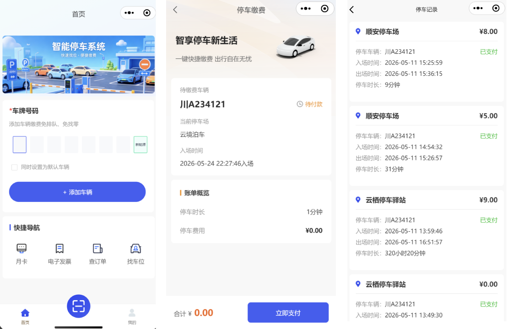
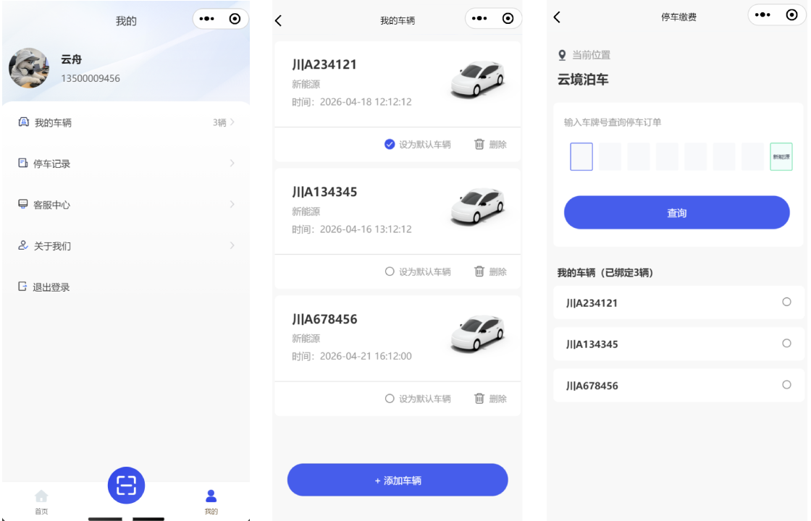
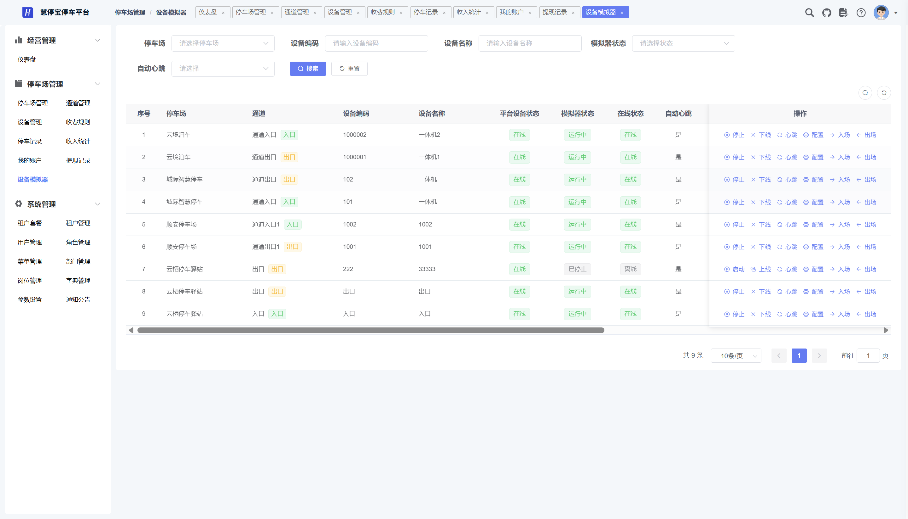

当前版本：2.8.1

[🔥 慧猫开源停车平台 · 后端微服务端](https://github.com/Roinli2561/HUIMAO-ParkOS-cloud)

[🔥 慧猫开源停车平台 · 前端源码](https://github.com/Roinli2561/HUIMAO-ParkOS-admin)（当前）

[🔥 慧猫开源停车平台 · 小程序源码](https://github.com/Roinli2561/HUIMAO-ParkOS-miniapp)

[🔥 个人博客](https://wenhui.huizhidata.com)

<div align="center">

# HUIMAO Parking · 运营管理后台

慧猫开源停车平台 · 管理端（Web PC，Vue 2 + Element UI）

</div>
<div align="center">
    
    
</div>
<p align="center">
  <a href="https://github.com/Roinli2561/HUIMAO-ParkOS-cloud">☁️ Cloud 云端服务</a> ·
  <b>🖥️ Admin 运营管理后台</b> ·
  <a href="https://github.com/Roinli2561/HUIMAO-ParkOS-miniapp">📱 MiniApp 车主小程序</a>
</p>
<p align="center">
  如果对您有帮助，您可以点右上角 "Star" ❤ 支持一下谢谢！
</p>

---

## 📖 项目介绍

HUIMAO Parking（慧猫开源停车平台）是一款基于 MIT 协议发布的开源停车场数字化解决方案，代码全开源无加密，可免费商用，适合各类物业、停车场运营方及开发者快速构建多租户一体化停车管理平台。







### 系统演示

管理后台在线体验：http://huimao.pc.huizhidata.com/

账号：hengtong
密码：admin123456

> 演示账号与云端服务仓库 README「系统演示」保持一致，如有变化以线上为准。

车主端小程序：扫码体验


整套系统分为三个端，数据统一、业务同步：

| 端 | 仓库 | 说明 |
| --- | --- | --- |
| ☁️ 云端服务 | [HUIMAO-ParkOS-cloud](https://github.com/Roinli2561/HUIMAO-ParkOS-cloud) | 后端微服务（Spring Cloud Alibaba） |
| 🖥️ 运营管理后台 | **HUIMAO-ParkOS-admin（本仓库）** | Web PC 管理端 |
| 📱 车主小程序 | [HUIMAO-ParkOS-miniapp](https://github.com/Roinli2561/HUIMAO-ParkOS-miniapp) | 车主端（uni-app，可发布微信小程序 / H5） |

本仓库为**运营管理后台**，面向平台运营方与停车场经营者，提供租户管理、停车场管理、通道设备管理、收费规则配置、停车记录与订单追踪、经营统计、账户与提现审核等运营功能，配合车主小程序实现"停车缴费"闭环，覆盖停车经营全流程。

### 核心功能

#### 停车运营管理
- 停车场管理：停车场档案维护与状态管理
- 通道管理：出入口通道配置
- 设备管理：道闸、摄像头、显示屏等设备接入与联动
- 收费规则配置：按停车场配置分段计时收费规则
- 停车记录：出入场记录与订单追踪
- 经营统计：收入、订单等多维度统计看板
- 设备模拟器：模拟车辆入场 / 出场事件，便于演示与联调

#### 财务结算
- 租户账户管理、余额查询
- 提现申请与审核
- 收入统计

#### 多租户与平台
- 租户管理、租户套餐、租户间数据隔离
- 用户、角色、菜单、部门、岗位管理（RBAC，可精确到按钮级权限）
- 数据字典、系统参数、通知公告
- 操作日志、登录日志

#### 系统底座
- 定时任务（XXL-JOB）
- 代码生成、表单构建
- 在线用户、缓存、服务监控

## 💻 技术架构

```
Vue 2.6 + Vue Router + Vuex
Element UI 2.15.x
axios（请求封装、统一鉴权）
ECharts 5（经营数据看板）
vue-cli 4.x（工程构建）
```

- 管理后台通过云端服务网关调用 RESTful 接口，统一鉴权与租户隔离由云端服务负责
- 兼容主流现代浏览器
- 开发环境接口默认代理至演示网关（见 `vue.config.js`），可在 `.env.*` 中调整

## 🚀 快速开始

环境要求：Node.js（建议 14+）

```bash
# 安装依赖
npm install

# 启动开发服务（默认端口 80）
npm run dev
```

浏览器访问 http://localhost:80

- 开发环境接口默认指向 `http://182.40.195.136:48081`（见 `vue.config.js` 代理与 `.env.development` 的 `VUE_APP_BASE_API`），接入自有云端服务时修改即可
- 构建生产包：

```bash
npm run build:prod
```

## 📁 目录结构

```
src/
├── api/         接口封装（system / job / monitor / tool / parking）
├── assets/      静态资源、图标、样式
├── components/  通用组件
├── layout/      整体布局
├── router/      路由
├── store/       Vuex
├── utils/       工具方法
└── views/       页面（dashboard / system / parking / job / monitor / tool）
```

## 📚 相关资料

- ☁️ 云端服务：https://github.com/Roinli2561/HUIMAO-ParkOS-cloud
- 📱 车主小程序：https://github.com/Roinli2561/HUIMAO-ParkOS-miniapp

---

© 2026 HUIMAO Parking 版权所有
开源协议：MIT